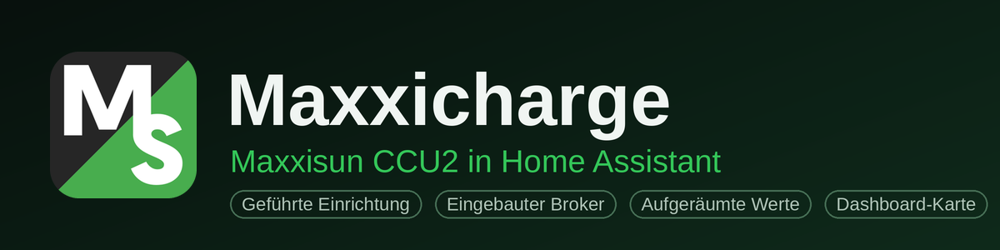
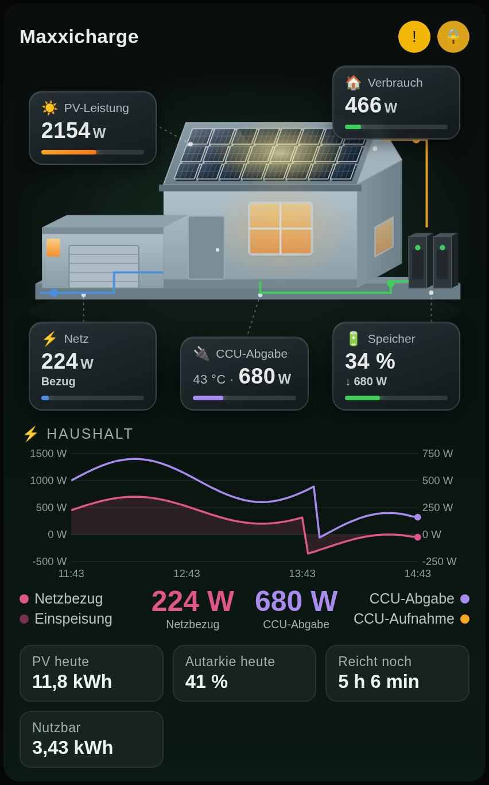
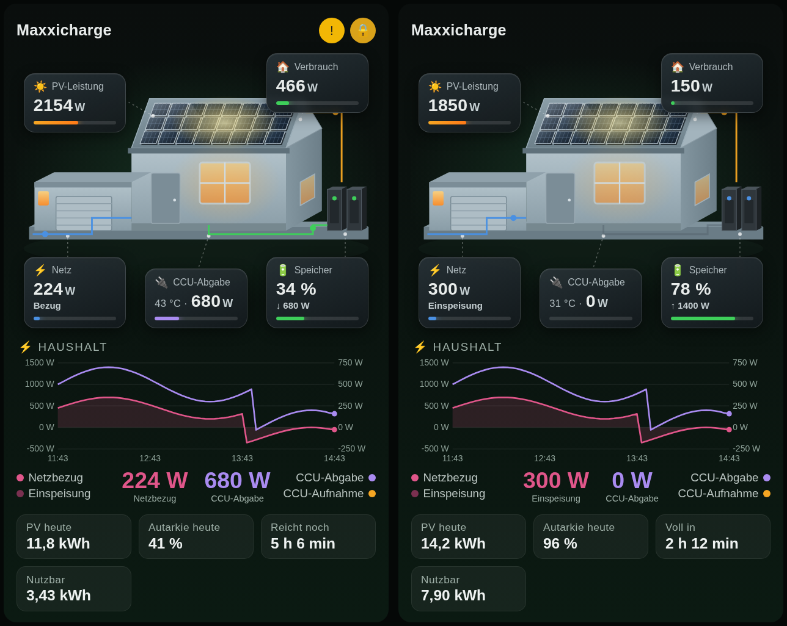
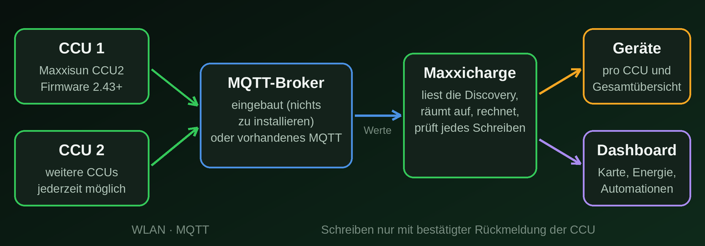
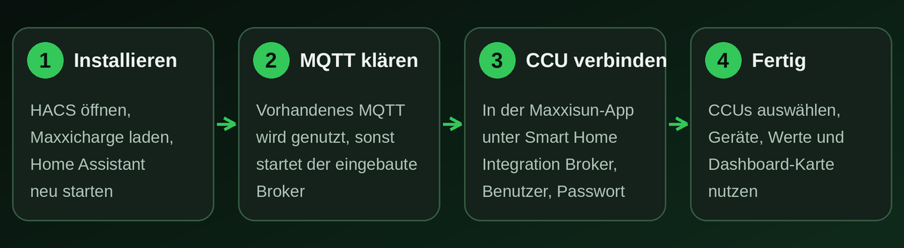

<p align="center">
  
</p>

<p align="center">
  <a href="https://hacs.xyz"></a>
  <a href="https://github.com/DerSpletti/ha-maxxicharge/releases"></a>
  <a href="LICENSE"></a>
  
</p>

**Bring your Maxxisun storage into Home Assistant, without manual work and without clutter.** The integration guides you
through setup, tidies the ~70 values per CCU, protects you from silent failures when changing settings, and ships its own
dashboard card in the style of the Maxxisun app.

*Deutsche Version: [README.md](README.md)*

> **Beta and unofficial.** Developed and tested with two CCUs (firmware 2.43.21 and 2.43.53) on the built-in broker.
> Changing settings and running with an existing MQTT broker have seen little real-hardware testing so far. This project is
> not affiliated with the manufacturer (see [Trademarks and liability](#trademarks-and-liability)).

## Contents
[At a glance](#at-a-glance) · [Preview](#preview) · [How it works](#how-it-works) · [Setup](#setup-in-4-steps) ·
[Entities](#what-you-get) · [Dashboard card](#dashboard-card) · [Changing settings safely](#changing-settings-safely) ·
[FAQ](#faq) · [Limitations](#known-limitations) · [Contributing](#reporting-issues-and-contributing)

## At a glance
| | |
|---|---|
| 🧭 **Guided setup** | Welcome page, instructions for the CCU, search on the broker. New CCUs show up by themselves as “Discovered” later. |
| 📦 **Nothing extra to install** | No MQTT? The integration starts **a small broker of its own**. Already have one (e.g. Mosquitto)? It is used. |
| 🧹 **Tidy** | Main values, energy, settings and diagnostics with proper names, one device per CCU. Raw values are off by default. |
| ✅ **Safe writing** | Settings are sent, confirmed by the CCU, otherwise rejected with an **error in the UI**. No silent jumping back. |
| 🔒 **Write protection** | One switch blocks all changes on all CCUs. |
| 📊 **Total overview** | State of charge, house consumption, self-sufficiency, self-consumption, remaining runtime across all CCUs, plus efficiency and charge cycles per CCU. |
| 🏠 **Own card** | House with PV and storage, tiles and history, no extra cards needed. |
| 🔐 **All local** | No cloud, no telemetry, no extra packages. |

## Preview
<p align="center">
  
  &nbsp;
  
</p>
<p align="center"><sub>The dashboard card, <b>preview with sample data</b>. Left: storage discharges, the house imports from the grid.
Right: PV charges the storage, surplus goes to the grid.</sub></p>

## How it works
<p align="center">
  
</p>

The CCUs connect to a broker via MQTT and describe their values (discovery). Maxxicharge reads that description, builds
tidy entities, calculates totals and verifies every change to the settings. There are no hard-coded topic names: everything
comes from the CCU’s discovery.

## Requirements
- Home Assistant **2025.1** or newer
- Maxxisun CCU2 with firmware **2.42.103** or newer for reading, **2.43** or newer to change settings
- CCU and Home Assistant on the same network

### Supported devices
| Device | Status |
|---|---|
| **Maxxicharge CCU V2+** (control unit “CCU2” / “CCU Gen2”, firmware 2.42.103+) | ✅ supported: reading from 2.42.103, changing settings from 2.43 |
| **Maxxicharge CCU V2** (older control unit without an MQTT interface) | ❌ not supported yet: it does not speak MQTT, which this integration builds on |

Both CCU types can regulate side by side on the same meter. The V2 stays untouched; it just does not show up in Home Assistant
through this integration.

## Setup in 4 steps
<p align="center">
  
</p>

### 1. Install
[](https://my.home-assistant.io/redirect/hacs_repository/?owner=DerSpletti&repository=ha-maxxicharge&category=integration)

Or HACS ⋮ → *Custom repositories* → `https://github.com/DerSpletti/ha-maxxicharge`, category *Integration*. Download
*Maxxicharge* and **restart** Home Assistant. Manual: copy `custom_components/maxxicharge` to `<config>/custom_components/`.

### 2. Add the integration
Settings → Devices & services → **Add integration → Maxxicharge**. The welcome page shows what you need: the IP of Home
Assistant, the port, user and password for MQTT.

If you **already have MQTT** (e.g. Mosquitto) the integration uses it. Otherwise choose the **built-in broker** and set port,
user and password (suggestion: port 1883, a random password without look-alike characters).

### 3. Connect the CCU
In the **Maxxisun app** under **Smart Home Integration**, for each CCU:

1. Switch **MQTT connection** on
2. **Broker address** and **port** as shown by the wizard
3. Switch **Login** on, enter **user name** and **password**
4. **Save**

> ⚠️ **Do not leave the password field empty**, otherwise the CCU keeps its old password.
> Alternatively use a browser: `http://<CCU-IP>/integrations/mqtt`. That page has **no login**, use it only in your home network.

### 4. Select the CCUs
The wizard lists the CCUs found. Pick them, done. You get one device **per CCU** and the device **“Maxxicharge Gesamt”**.

<details>
<summary><b>Adding CCUs later, looking up connection data, changing the password</b></summary>

- **New CCU:** give it the same connection data in the app. It appears by itself under *Devices & services* as “Discovered”
  and can be set up with one click. Or add the integration again.
- **Look up connection data:** entry → **Configure → Show connection details for the CCU**. Broker, port, user and password
  are listed exactly as they must be entered in the app.
- **Change password** (built-in broker only): entry → Configure → *Change password*. It applies to all CCUs; afterwards enter
  it in the app for every CCU.
- **With an existing MQTT broker** the integration does not know the password. Your broker’s user and password apply
  (Settings → People → Users or the broker configuration).
- **Old autodiscovery entities** of the CCU can be **disabled** under Configure → Settings (nothing is deleted).
</details>

## What you get
| Area | Examples |
|---|---|
| **Main values** | State of charge, usable energy, battery charge/discharge power, CCU AC power, grid power, PV power, operating mode, battery full/empty |
| **Energy** | Output/input today and total, grid import/export, PV yield, battery charged/discharged, grid and battery balance |
| **Configuration** | Max. output power, max. charge power, min/max charge level, output on meter loss, charging strategy, UPS mode |
| **Calculated per CCU** | Round-trip efficiency, charge cycles, remaining runtime, time to full |
| **Total overview** | State of charge total, house consumption, self-sufficiency, self-consumption, PV total, grid power, **write protection** |
| **Diagnostics** | Connected, last update, firmware, IP address, temperature, uptime, fault flags, writing possible |

Sign convention of the CCU: positive = battery discharging / CCU feeding the house / grid import, negative = the opposite.
The energy counters are **estimates** stored by the CCU roughly every 5 minutes, not for billing. House consumption,
self-sufficiency and self-consumption are **approximations** from meter and CCU values. The total overview assumes that all
CCUs share the same meter.

## Dashboard card
After setup the card **Maxxicharge** appears in the card picker (reload the browser cache once if it is missing). Via YAML:
```yaml
type: custom:maxxicharge-card
title: Maxxicharge        # optional
hours: 3                  # history range in hours
pv_max: 4000              # bar scales in W (optional)
house_max: 3000
ccu_max: 2300
```
The card finds the entities of the total overview automatically. You can override single ones:
`entities: { pv: sensor.my_pv, grid: sensor.my_grid }`. Keys: `pv`, `charge`, `discharge`, `grid`, `house`, `soc`, `feed`,
`draw`, `runtime`, `ttf`, `autarky`, `usable`, `pvtoday`, `temp`, `fault`, `lock`, `online`.
An example with single cards per CCU is in [`examples/dashboard.yaml`](examples/dashboard.yaml).

## Changing settings safely
The integration sends the value and waits up to 10 seconds for the CCU to report it back. Then it is **stored**, which does not
mean the power changes immediately. If the CCU rejects it or does not answer, you get an **error message** and the entity shows
the real value again. There is no fixed target power (“discharge 300 W”): the CCU always regulates on its own meter. The
**write protection switch** on the “Maxxicharge Gesamt” device blocks all changes at once.

## FAQ
<details>
<summary><b>Do I need Mosquitto or another MQTT broker?</b></summary>
No. Without MQTT in Home Assistant the wizard offers the built-in broker. It runs as long as at least one CCU is set up. With
Mosquitto it works the same way, the integration detects it by itself.
</details>

<details>
<summary><b>The wizard does not find my CCU</b></summary>
The dialog lists the CCUs <b>connected</b> to the broker and those <b>rejected</b>, with the reason. If it says “password”, enter
user and password in the app again (not empty) and choose “Search again”. If the CCU is listed as connected but not offered, it
has not announced its entities yet. Wait a moment and search again.
</details>

<details>
<summary><b>A CCU is listed under “Repairs” as rejected</b></summary>
The credentials at the CCU do not match. Look them up under entry → Configure → Show connection details and enter them in the
app again. The notice disappears as soon as the CCU can log in.
</details>

<details>
<summary><b>Values are “unavailable”</b></summary>
The CCU has not reported for two minutes. Check the CCU’s Wi-Fi and the broker.
</details>

<details>
<summary><b>Writing says “not applied”</b></summary>
Firmware 2.43 or newer? Does the CCU report the setting back at all (value not “unknown”)? Is write protection off? See the log.
</details>

<details>
<summary><b>How do I get logs and diagnostics?</b></summary>

```yaml
logger:
  default: warning
  logs:
    custom_components.maxxicharge: debug
```
The **diagnostics download** (entry → ⋮ → Download diagnostics) contains topics and values. IP, CCU ID and passwords are redacted.
</details>

## Known limitations
- **Writing needs firmware 2.43+.** With older firmware the integration refuses with an error, logs a warning and creates a
  notice under *Repairs*.
- **Older firmware may not report settings back** (e.g. 2.43.21 on one tested CCU). The values stay “unknown” and a write
  cannot be confirmed. A firmware update via the Maxxisun app helps.
- The older **Maxxicharge CCU V2** without MQTT is not supported (see [Supported devices](#supported-devices)).
- The **built-in broker** is deliberately small: login, publish/subscribe, retained, last will, MQTT 3.1.1 and 5, **no
  encryption**, at most 20 clients. If another service uses port 1883, choose another port.
- The CCU’s MQTT connection is **unencrypted**. Use it only in a trusted home network.
- Old autodiscovery entity IDs are not migrated. Automations and dashboards must be switched to the new entities
  (`sensor.ccu_xxxx_…`).

## Privacy and security
- Everything runs **locally**. No cloud connection, no telemetry.
- The built-in broker password is stored in the integration’s configuration, in no entity and not in the diagnostics download.
- The built-in broker listens on all network interfaces of Home Assistant and requires login. Do not expose it to the internet.

## Updates and removal
HACS announces updates (Settings → Updates). Home Assistant must be restarted after installing, as with every integration. To
remove, delete the entry and uninstall in HACS. Changes are listed in the [changelog](CHANGELOG.md).

## Reporting issues and contributing
Issues and ideas are welcome as [GitHub issues](https://github.com/DerSpletti/ha-maxxicharge/issues), with Home Assistant version,
CCU firmware, diagnostics download and a debug log excerpt (remove passwords).

For developers: the entity catalog is in `custom_components/maxxicharge/const.py`; translations are generated from it with
`python3 scripts/generate_translations.py`. The diagrams in this README come from `scripts/make_docs_images.py` (Pillow). The tests
under `tests/` run without Home Assistant (`paho-mqtt` for the broker tests).

## Trademarks and liability
This is an **unofficial** project and not affiliated with Maxxihandel GmbH. *Maxxisun* and *Maxxicharge* are trademarks of the
manufacturer. The icon and logo in `custom_components/maxxicharge/brand/` and in the banner come from maxxisun.de and only
identify the related hardware. They will be removed on the manufacturer’s request. Use at your own risk; changing settings on the
storage is your own responsibility. License: [MIT](LICENSE) (applies to the code, not to the trademarks).
