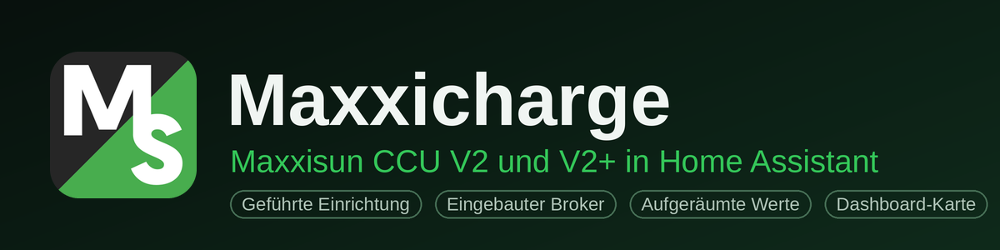
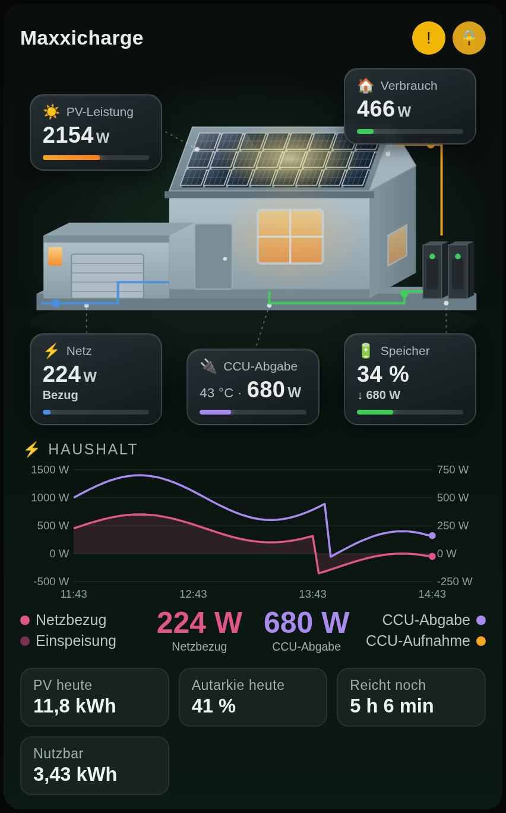
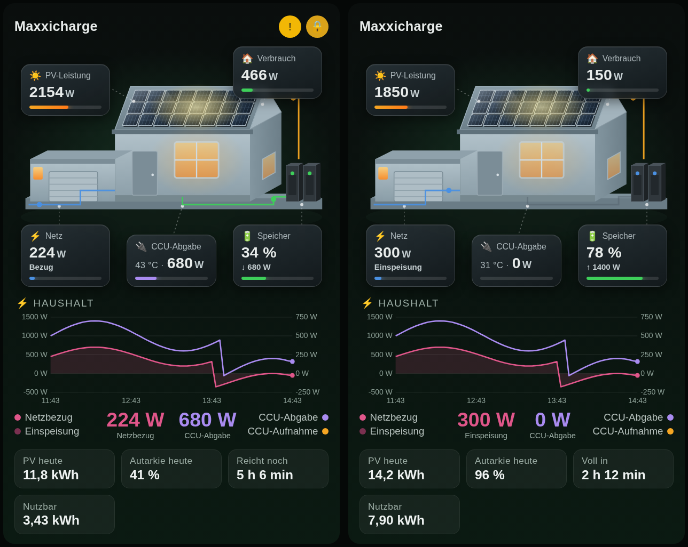
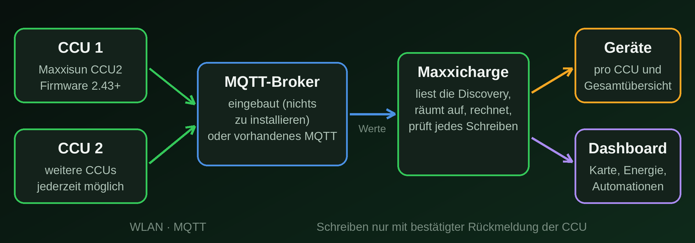
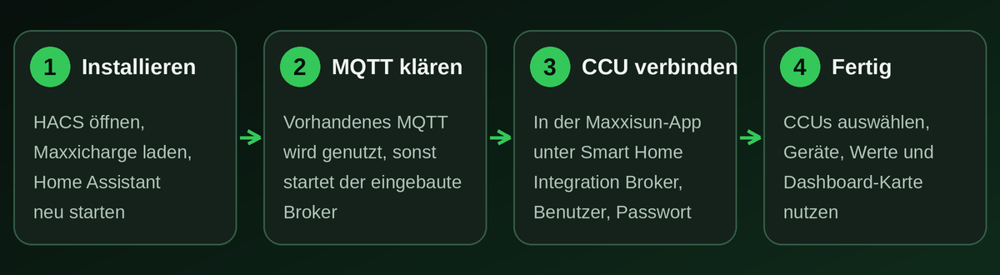

<p align="center">
  
</p>

<p align="center">
  <a href="https://hacs.xyz"></a>
  <a href="https://github.com/DerSpletti/ha-maxxicharge/releases"></a>
  <a href="LICENSE"></a>
  
</p>

**Bring deine Maxxisun-Speicher in Home Assistant, ohne Handarbeit und ohne Chaos.** Die Integration führt dich durch die
Einrichtung, räumt die rund 70 Werte pro CCU auf, schützt vor stillen Fehlern beim Ändern von Einstellungen und
bringt eine eigene Dashboard-Karte im Stil der Maxxisun-App mit.

*English version: [README.en.md](README.en.md)*

> **Version 0.9.1 (Vorabversion), privat gepflegt.** Entwickelt und getestet mit zwei CCUs (Firmware 2.43.21 und 2.43.53) am eingebauten Broker.
> Das Ändern von Einstellungen und der Betrieb mit einem vorhandenen MQTT-Broker sind auf echter Hardware noch wenig
> erprobt. Es ist keine offizielle Veröffentlichung des Herstellers (siehe [Marken und Haftung](#marken-und-haftung)).

## Inhalt
[Auf einen Blick](#auf-einen-blick) · [Vorschau](#vorschau) · [So funktioniert es](#so-funktioniert-es) ·
[Einrichtung](#einrichtung-in-4-schritten) · [Entities](#was-du-bekommst) · [Dashboard-Karte](#dashboard-karte) ·
[Sicher schreiben](#einstellungen-sicher-ändern) · [Fragen und Fehlersuche](#häufige-fragen) ·
[Einschränkungen](#bekannte-einschränkungen) · [Mitmachen](#fehler-melden-und-mitmachen)

## Auf einen Blick
| | |
|---|---|
| 🧭 **Geführte Einrichtung** | Willkommensseite, Anleitung für die CCU, Suche am Broker. Neue CCUs erscheinen später von selbst als „Entdeckt“. |
| 📦 **Nichts extra installieren** | Hast du kein MQTT, startet die Integration einen **eigenen kleinen Broker**. Hast du eins (z. B. Mosquitto), wird es genutzt. |
| 🧹 **Aufgeräumt** | Hauptwerte, Energie, Einstellungen und Diagnose mit deutschen Namen, ein Gerät pro CCU. Rohwerte sind standardmäßig aus. |
| ✅ **Sicheres Schreiben** | Einstellungen werden gesendet, von der CCU bestätigt und sonst mit **Fehlermeldung im UI** abgelehnt. Kein stilles Zurückspringen. |
| 🔒 **Schreibschutz** | Ein Schalter sperrt alle Änderungen an allen CCUs. |
| 📊 **Gesamtübersicht** | Ladestand, Hausverbrauch, Autarkie, Eigenverbrauch, Restlaufzeit über alle CCUs. Dazu Wirkungsgrad und Ladezyklen je CCU. |
| 🏠 **Eigene Karte** | Haus mit PV und Speicher, Kacheln und Verlauf, ohne Zusatzkarten. |
| 🔐 **Alles lokal** | Keine Cloud, keine Telemetrie, keine Zusatzpakete. |

## Vorschau
<p align="center">
  
  &nbsp;
  
</p>
<p align="center"><sub>Die Dashboard-Karte, <b>Vorschau mit Beispieldaten</b>. Links: Speicher entlädt, Haus bezieht Netzstrom.
Rechts: PV lädt den Speicher, überschüssige Leistung geht ins Netz.</sub></p>

## So funktioniert es
<p align="center">
  
</p>

Die CCUs melden sich per MQTT an einem Broker und beschreiben dabei ihre Werte (Discovery). Maxxicharge liest diese
Beschreibung, baut daraus aufgeräumte Entities, rechnet Gesamtwerte und prüft jede Änderung an den Einstellungen.
Es gibt keine fest eingebauten Topic-Namen: Alles kommt aus der Discovery der CCU.

## Voraussetzungen
- Home Assistant **2025.1** oder neuer
- Maxxisun **CCU V2 oder V2+** mit Firmware **2.42.103** oder neuer zum Lesen, **2.43** oder neuer zum Ändern von Einstellungen
- CCU und Home Assistant im selben Netz

### Unterstützte Geräte
| Modell | Status |
|---|---|
| **Maxxicharge CCU V2+** | ✅ unterstützt: Lesen ab Firmware 2.42.103, Einstellungen ändern ab 2.43 |
| **Maxxicharge CCU V2** | ✅ unterstützt, sobald die CCU die MQTT-Schnittstelle hat (Firmware ab 2.42.103). Eine CCU mit älterer Firmware ohne MQTT lässt sich nicht einbinden. |

Beide Modelle melden sich mit einer Seriennummer der Form `CCU2-XXXX-XXXX-XXXX` und lassen sich nebeneinander am selben Zähler betreiben.

**Modellerkennung:** Die Integration fragt bei jeder CCU `http://<IP>/api/info` ab (nur lesend, nur Adressen im Heimnetz) und zeigt das
Ergebnis als Gerätemodell und als Diagnose-Sensor **Modell**. Es gilt: Meldet die CCU `CCU2_PLUS`, ist es eine **CCU V2+**.
Jede andere Antwort (bei einer getesteten CCU steht dort `UNKNOWN`) ist eine normale **CCU V2**. Nur wenn die CCU gar nicht antwortet,
steht „Unbekannt“. Liegt die Erkennung einmal falsch, lässt sich das Modell unter Eintrag → Konfigurieren → Einstellungen von Hand festlegen.

## Einrichtung in 4 Schritten
<p align="center">
  
</p>

### 1. Installieren
[](https://my.home-assistant.io/redirect/hacs_repository/?owner=DerSpletti&repository=ha-maxxicharge&category=integration)

Oder in HACS ⋮ → *Benutzerdefinierte Repositories* → `https://github.com/DerSpletti/ha-maxxicharge`, Kategorie
*Integration*. *Maxxicharge* herunterladen, Home Assistant **neu starten**.
Manuell: Ordner `custom_components/maxxicharge` nach `<config>/custom_components/` kopieren.

### 2. Integration hinzufügen
Einstellungen → Geräte & Dienste → **Integration hinzufügen → Maxxicharge**. Die Willkommensseite zeigt dir, was du
brauchst: die IP von Home Assistant, den Port, Benutzer und Passwort für MQTT.

Hast du **schon MQTT** (z. B. Mosquitto), nutzt die Integration es. Sonst wählst du den **eingebauten Broker** und legst
Port, Benutzer und Passwort fest (Vorschlag: Port 1883, ein Zufallspasswort ohne verwechselbare Zeichen).

### 3. CCU verbinden
In der **Maxxisun-App** unter **Smart Home Integration**, für jede CCU:

1. **MQTT-Verbindung** einschalten
2. **Broker-Adresse** und **Port** wie im Assistenten angezeigt
3. **Anmeldung** einschalten, **Benutzername** und **Passwort** eintragen
4. **Speichern**

> ⚠️ **Passwortfeld nicht leer lassen**, sonst behält die CCU ihr altes Passwort.
> Alternativ geht es im Browser über `http://<IP-DER-CCU>/integrations/mqtt`. Diese Seite hat **keinen Login**,
> nutze sie nur im Heimnetz.

### 4. CCUs auswählen
Der Assistent zeigt die gefundenen CCUs. Wähle sie aus, fertig. Es entsteht ein Gerät **pro CCU** und das Gerät
**„Maxxicharge Gesamt“**.

<details>
<summary><b>Weitere CCUs später hinzufügen, Verbindungsdaten nachlesen, Passwort ändern</b></summary>

- **Neue CCU:** in der App mit den gleichen Verbindungsdaten versehen. Sie erscheint von selbst unter *Geräte & Dienste*
  als „Entdeckt“ und lässt sich mit einem Klick einrichten. Alternativ die Integration erneut hinzufügen.
- **Verbindungsdaten nachlesen:** Eintrag → **Konfigurieren → Verbindungsdaten für die CCU anzeigen**. Dort stehen Broker,
  Port, Benutzer und Passwort genau so, wie sie in die App gehören.
- **Passwort ändern** (nur eingebauter Broker): Eintrag → Konfigurieren → *Passwort ändern*. Es gilt für alle CCUs, danach
  muss es in der App bei jeder CCU neu eingetragen werden.
- **Mit vorhandenem MQTT** kennt die Integration das Passwort nicht. Es gelten Benutzer und Passwort deines Brokers
  (Einstellungen → Personen → Benutzer oder Broker-Konfiguration).
- **Alte Autodiscovery-Entities** der CCU lassen sich unter Konfigurieren → Einstellungen **deaktivieren** (nichts wird gelöscht).
</details>

## Was du bekommst
| Bereich | Beispiele |
|---|---|
| **Hauptwerte** | Ladestand, Nutzbare Restenergie, Batterie Lade-/Entladeleistung, CCU-Leistung (AC), Netzleistung, PV-Leistung, Betriebsmodus, Speicher voll/leer |
| **Energie** | Abgabe/Aufnahme heute und gesamt, Netzbezug/-einspeisung, PV-Ertrag, Batterie geladen/entladen, Netz- und Batteriebilanz |
| **Konfiguration** | Max. Ausgangsleistung, Max. Ladeleistung, Mindest-/Maximaler Ladestand, Leistung bei Zählerausfall, Ladestrategie, USV-Modus |
| **Pro CCU berechnet** | Wirkungsgrad, Ladezyklen, Restlaufzeit, Zeit bis voll |
| **Gesamtübersicht** | Ladestand gesamt, Hausverbrauch, Autarkiegrad, Eigenverbrauchsquote, PV gesamt, Netzleistung, **Schreibschutz** |
| **Diagnose** | Verbunden, Letztes Update, Firmware, IP-Adresse, Temperatur, Laufzeit, Fehler-Flags, Schreiben möglich |

Vorzeichen der CCU: positiv = Batterie entlädt bzw. CCU speist ins Haus bzw. Netzbezug, negativ = umgekehrt.
Die Energiezähler sind **Schätzwerte**, die die CCU etwa alle 5 Minuten speichert, nicht für die Abrechnung.
Hausverbrauch, Autarkie- und Eigenverbrauchsquote sind **Näherungen** aus Zähler- und CCU-Werten. Die Gesamtübersicht
geht davon aus, dass alle CCUs am selben Zähler hängen.

## Dashboard-Karte
Die Karte **Maxxicharge** steht nach der Einrichtung in der Kartenauswahl (den Browser-Cache einmal neu laden, falls sie
fehlt). Sie funktioniert für die **Gesamtübersicht** und für **jede einzelne CCU** und ist **modular**: Im Karten-Editor wählst du das
**Gerät**, die **Bausteine** (Haus-Grafik, Kacheln, Verlauf „Haushalt“, Kennzahlen) und die **Kacheln** (PV, Verbrauch, Netz,
CCU-Abgabe, Speicher) aus. Per YAML:
```yaml
type: custom:maxxicharge-card
device: <Geräte-ID>                       # Startgerät; leer = Maxxicharge Gesamt (im Editor per Auswahl)
switcher: true                            # Umschalter Gesamt / CCUs in der Karte (Standard: an, wenn kein Gerät festgelegt ist)
modules: [scene, tiles, chart, stats]     # Haus-Grafik, Kacheln, Verlauf, Kennzahlen
tiles: [pv, house, grid, ccu, store]      # welche Kacheln
title: Maxxicharge                        # leer = Gerätename
hours: 3                                  # Zeitraum des Verlaufs in Stunden
pv_max: 4000                              # Skala der Balken in W (optional)
house_max: 3000
ccu_max: 2300
```
Ist der **Umschalter** an, stehen oben in der Karte Reiter für „Maxxicharge Gesamt“ und jede CCU. Ein Klick wechselt die Anzeige direkt in der
Karte (die Auswahl wird im Browser gemerkt). Legst du ein festes Gerät fest, ist der Umschalter standardmäßig aus; mit `switcher: true` kannst du ihn trotzdem einschalten.
Ohne Haus-Grafik ordnen sich die Kacheln als Raster an, so lässt sich zum Beispiel eine kompakte Karte nur mit Speicher und
CCU-Abgabe bauen. Einzelne Entities lassen sich überschreiben: `entities: { pv: sensor.meine_pv, grid: sensor.mein_netz }`
(Schlüssel: `pv`, `charge`, `discharge`, `grid`, `house`, `soc`, `feed`, `draw`, `runtime`, `ttf`, `autarky`, `usable`,
`pvtoday`, `temp`, `fault`, `lock`, `online`). Bei einer einzelnen CCU gibt es keinen Autarkiegrad. Der Verbrauch wird nur
berechnet, wenn diese CCU einen Zählerwert hat.

### Maxxicharge-Seite und „Geräte-Informationen“
Home Assistant erlaubt Integrationen nicht, Karten direkt in die Geräteseite einzubauen. Deshalb gibt es eine eigene Seite
**Maxxicharge** (Seitenleiste, Adresse `/maxxicharge`) mit Reitern für die Gesamtübersicht, jede CCU und „Alle“. Auf der
Geräteseite jeder CCU und der Gesamtübersicht führt der Knopf **Besuchen** im Kasten **Geräte-Informationen** direkt zur
passenden Karte. Die Weboberfläche der CCU erreichst du von dort über den Knopf „CCU-Weboberfläche“.

## Einstellungen sicher ändern
Die Integration sendet den Wert und wartet bis zu 10 Sekunden, bis die CCU ihn zurückmeldet. Dann ist er **gespeichert**,
das heißt nicht, dass die Leistung sofort wechselt. Lehnt die CCU ab oder antwortet nicht, bekommst du eine **Fehlermeldung**,
und die Entity zeigt wieder den echten Wert. Eine feste Zielleistung („entlade 300 W“) gibt es nicht: Die CCU regelt immer
auf ihren eigenen Zähler. Mit dem **Schreibschutz-Schalter** im Gerät „Maxxicharge Gesamt“ sperrst du alle Änderungen auf einmal.

## Häufige Fragen
<details>
<summary><b>Brauche ich Mosquitto oder ein anderes MQTT?</b></summary>
Nein. Ohne MQTT in Home Assistant bietet der Assistent den eingebauten Broker an. Er läuft, solange mindestens eine CCU
eingerichtet ist. Mit Mosquitto geht es genauso, die Integration erkennt es selbst.
</details>

<details>
<summary><b>Der Assistent findet meine CCU nicht</b></summary>
Im Dialog stehen die mit dem Broker <b>verbundenen</b> und die <b>abgelehnten</b> CCUs samt Grund. Steht dort
„password“, trage Benutzer und Passwort in der App neu ein (nicht leer lassen) und wähle „Erneut suchen“. Steht die
CCU unter „verbunden“, aber nicht in der Auswahl, hat sie ihre Entities noch nicht gemeldet. Kurz warten und erneut suchen.
</details>

<details>
<summary><b>Eine CCU steht unter „Reparaturen“ als abgelehnt</b></summary>
Die Zugangsdaten an der CCU stimmen nicht. Sieh unter Eintrag → Konfigurieren → Verbindungsdaten nach und trage sie in der
App neu ein. Der Hinweis verschwindet, sobald sich die CCU anmelden kann.
</details>

<details>
<summary><b>Werte sind „nicht verfügbar“</b></summary>
Die CCU hat sich seit zwei Minuten nicht gemeldet. WLAN der CCU und den Broker prüfen.
</details>

<details>
<summary><b>Schreiben meldet „nicht übernommen“</b></summary>
Firmware 2.43 oder neuer? Meldet die CCU die Einstellung überhaupt zurück (Wert nicht „unbekannt“)? Ist der
Schreibschutz aus? Details stehen im Log.
</details>

<details>
<summary><b>Wie bekomme ich Logs und Diagnosedaten?</b></summary>

```yaml
logger:
  default: warning
  logs:
    custom_components.maxxicharge: debug
```
Der **Diagnose-Download** (Eintrag → ⋮ → Diagnose herunterladen) enthält Topics und Werte. IP, CCU-ID und Passwörter
sind geschwärzt.
</details>

## Bekannte Einschränkungen
- **Schreiben nur ab Firmware 2.43.** Bei älterer Firmware verweigert die Integration das mit einer Fehlermeldung, warnt im
  Log und legt einen Hinweis unter *Reparaturen* an.
- **Ältere Firmware meldet Einstellungen teils nicht zurück** (z. B. 2.43.21 bei einer der getesteten CCUs). Die Werte bleiben
  „unbekannt“, und ein Schreibzugriff kann nicht bestätigt werden. Ein Firmware-Update über die Maxxisun-App hilft.
- Eine CCU, die keine MQTT-Schnittstelle hat (Firmware vor 2.42.103), wird nicht unterstützt. Siehe [Unterstützte Geräte](#unterstützte-geräte).
- Der **eingebaute Broker** ist bewusst klein: Anmeldung, Publish/Subscribe, Retained, Last Will, MQTT 3.1.1 und 5,
  **keine Verschlüsselung**, höchstens 20 Clients. Belegt ein anderer Dienst den Port 1883, wähle einen anderen Port.
- Die MQTT-Verbindung der CCU ist **unverschlüsselt**. Nur im vertrauenswürdigen Heimnetz betreiben.
- Alte Entity-IDs der Autodiscovery werden nicht migriert. Automationen und Dashboards müssen auf die neuen Entities
  (`sensor.ccu_xxxx_…`) umgestellt werden.

## Datenschutz und Sicherheit
- Alles läuft **lokal**. Es gibt keine Cloud-Verbindung und keine Telemetrie.
- Das Passwort des eingebauten Brokers steht in der Konfiguration der Integration, in keiner Entity und nicht im
  Diagnose-Download.
- Der eingebaute Broker lauscht auf allen Netzwerkschnittstellen von Home Assistant und verlangt Anmeldung. Setze ihn nicht ins Internet.

## Updates und Deinstallation
Updates meldet HACS (Einstellungen → Updates). Nach dem Installieren muss Home Assistant neu gestartet werden, das ist
bei allen Integrationen so. Zum Entfernen den Eintrag löschen und in HACS deinstallieren. Änderungen stehen im
[Changelog](CHANGELOG.md).

## Fehler melden und mitmachen
Fehler und Ideen gern als [GitHub-Issue](https://github.com/DerSpletti/ha-maxxicharge/issues), mit Home-Assistant-Version,
CCU-Firmware, Diagnose-Download und dem Log-Ausschnitt (Debug-Log, Passwörter entfernen).

Für Entwickler: Der Entity-Katalog steht in `custom_components/maxxicharge/const.py`, die Übersetzungen entstehen daraus
mit `python3 scripts/generate_translations.py`. Die Schaubilder dieser README entstehen mit
`scripts/make_docs_images.py` (Pillow). Die Tests unter `tests/` laufen ohne Home Assistant (`paho-mqtt` für die
Broker-Tests).

## Marken und Haftung
Dies ist ein privat gepflegtes Projekt und keine offizielle Veröffentlichung der Maxxihandel GmbH. *Maxxisun* und *Maxxicharge* sind Marken des
Herstellers. Icon und Logo in `custom_components/maxxicharge/brand/` und im Banner werden **mit Genehmigung des Herstellers** verwendet und
kennzeichnen die zugehörige Hardware (siehe [NOTICE.md](NOTICE.md)). Die Nutzung erfolgt auf eigene Gefahr, das Ändern von Einstellungen am
Speicher geschieht auf eigene Verantwortung. Lizenz: [MIT](LICENSE) (gilt für den Code, nicht für die Marken).
